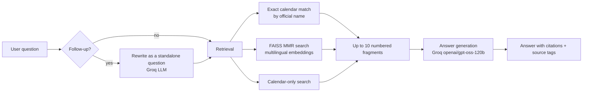

<p align="center">
  
</p>

# KnowBot

**KnowBot** is a Retrieval-Augmented Generation (RAG) chatbot that answers questions about the official documents of the University of Cundinamarca: the undergraduate student regulations, Agreement 005, the Student Regulations Commission report and the 2026 academic calendar.

Every answer is written only from the official documents, cites the fragments it used (`[1]`, `[2]`…) and shows the document and page of each citation. When the documents do not contain the answer, KnowBot says so instead of guessing.

## Features

- **Grounded answers with citations** – the model may only use the retrieved fragments; the cited document pages are shown as tags below each answer.
- **Quick questions** – 50 student situations, 30 course homologations and 67 calendar activities, one click away under the welcome message.
- **Reliable calendar dates** – the calendar PDF is read cell by cell, and calendar activities are looked up by their official name instead of by similarity only.
- **Follow-up questions** – "And for postgraduate students?" is rewritten into a full question using the conversation.
- **Live answers** – the answer is shown while it is being written.
- **Always in English** – questions can be asked in English or Spanish; answers are always in English.
- **User feedback** – 👍/👎 on every answer, saved to `logs/feedback.csv`.
- **Evaluation** – a 100-question validation set with retrieval and answer metrics (see [Evaluation](#evaluation)).

## How it works



1. **Ingestion** (`core/ingestion.py`) – the PDFs in `data/documents/` are split into ~1000-character chunks. The academic calendar is a wide table, so each activity is rebuilt from the table cells as one line with its dates.
2. **Embeddings** – [FastEmbed](https://github.com/qdrant/fastembed) runs the multilingual `paraphrase-multilingual-MiniLM-L12-v2` model locally (no GPU, no API key) and the vectors are stored in a [FAISS](https://github.com/facebookresearch/faiss) index (`vector_store/`).
3. **Retrieval** (`core/pipeline.py`) – exact calendar matches first, then Maximal Marginal Relevance (MMR) search, then a calendar-only search for date questions.
4. **Generation** – [Groq](https://groq.com/) runs `openai/gpt-oss-120b` (short reasoning, about 2,300 tokens per answer) with a system prompt that forbids external knowledge and requires citations. Groq limits are per model: when `gpt-oss-120b` runs out of its daily tokens, `openai/gpt-oss-20b` writes the answer instead; follow-up questions are always rewritten by `gpt-oss-20b`. Both models can be changed with the `GROQ_MODEL` and `GROQ_FALLBACK_MODEL` environment variables.
5. **Interface** (`app.py`) – [Streamlit](https://streamlit.io/) chat with quick questions, source tags and feedback.

## Project structure

```
KnowBot/
├── app.py                   # Streamlit interface
├── core/
│   ├── __init__.py          # FastEmbed embeddings wrapper
│   ├── ingestion.py         # PDF reading, calendar table parsing, FAISS index build
│   ├── pipeline.py          # Retrieval, follow-ups, generation and citations
│   └── calendar_names.py    # English ↔ official names of the calendar activities
├── data/documents/          # Official PDFs
├── vector_store/            # FAISS index (rebuilt by core/ingestion.py)
├── eval/
│   ├── evaluate.py          # Evaluation script
│   ├── validation_questions.csv
│   └── results/             # Metrics produced by evaluate.py
├── assets/                  # Logo and avatar (PNG + editable SVG)
├── .streamlit/config.toml   # Theme
├── requirements.txt
└── render.yaml              # Render deployment
```

## Getting started

Requirements: Python 3.12 and a free [Groq API key](https://console.groq.com/keys).

```bash
# 1. Create and activate a virtual environment
python -m venv .venv
.venv\Scripts\activate          # Windows
source .venv/bin/activate       # macOS / Linux

# 2. Install the dependencies
pip install -r requirements.txt

# 3. Add your Groq API key to a .env file in the project folder
echo GROQ_API_KEY=your_key_here > .env

# 4. (Only if you change the PDFs) rebuild the index
python core/ingestion.py

# 5. Start the app
streamlit run app.py
```

The app opens at <http://localhost:8501>. The first question takes a little longer because the embedding model is loaded once.

## Evaluation

`eval/validation_questions.csv` contains 100 questions, each with the document and page that answer it.

```bash
python eval/evaluate.py                # retrieval metrics, no API calls
python eval/evaluate.py --answers 20   # also answers 20 random questions and grades them with an LLM judge
```

The results are written to `eval/results/` (`summary.md`, `retrieval.csv`, `answers.csv`). Latest results:

<!-- EVAL_RESULTS_START -->
**Retrieval** (100 questions, no API calls):

| Metric | First version | Current version |
|---|---|---|
| Correct document, first result | 80% | 81% |
| Correct page, first result | 44% | 46% |
| Correct document in the top 6 fragments | 99% | 99% |
| Correct page (±1) in the top 6 fragments | 73% | 88% |

The improvement comes from the exact calendar lookup, the article-number lookup ("Article 35" → `ARTÍCULO 35`) and the order in which the three searches are combined. MMR settings were also compared (λ = 0.5–0.9, fetch_k = 40/80): the differences stayed within about 3 points, so the default λ = 0.6, fetch_k = 40 was kept.

**Answers** (20 random questions, seed 7, graded by an LLM judge against the text of the expected page; run on 2026-10-29):

| Verdict | Questions | Share |
|---|---|---|
| Correct | 10 | 50% |
| Partial | 2 | 10% |
| Incorrect | 8 | 40% |

4 of the 8 incorrect answers say the information was not found: the expected page was not retrieved, and 3 of them ask about the Commission report, a slide deck with little text whose date questions ("meeting held on 16 November 2021") pull in date-heavy calendar lines instead. The other 4 have content errors (a wrong date, a missing three-year limitation period, two procedures mixed). Retrieval of that report is the main area to improve. Per-question reasons are in `eval/results/answers.csv`.
<!-- EVAL_RESULTS_END -->

## Deployment

The app is deployed on [Render](https://render.com/) with `render.yaml`: the build installs the requirements and rebuilds the index, and `GROQ_API_KEY` is set as an environment variable in the Render dashboard. A GitHub Actions workflow (`.github/workflows/keep-alive.yml`) pings the app every 10 minutes so the free instance does not sleep.

On Render the file system is temporary, so `logs/feedback.csv` is reset on every deploy; download it or move it to a database for long-term analysis.

## Limitations

- KnowBot only knows the four indexed documents; any other question is answered with "not found".
- The calendar covers 2026 only.
- Answer quality is graded by an LLM judge, which approximates but does not replace a human review.
- The Groq free tier allows 8,000 tokens per minute and 200,000 tokens per day per model. When both models are out of quota, KnowBot shows a rate-limit message (HTTP 429) until the quota recovers; the evaluation uses the same quota, so avoid running it on presentation day.

## Tech stack

Python 3.12 · Streamlit · LangChain · FAISS · FastEmbed · Groq (`openai/gpt-oss-120b`) · pdfplumber · pypdf
