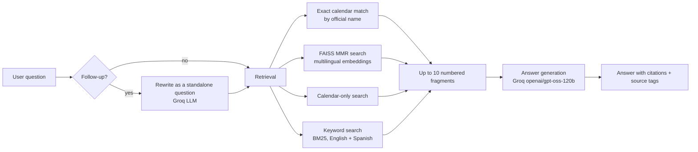

<p align="center">
  
</p>

# KnowBot

**KnowBot** is a Retrieval-Augmented Generation (RAG) chatbot that answers questions about the official documents of the University of Cundinamarca: the undergraduate student regulations, Agreement 005, the Student Regulations Commission report and the 2026 academic calendar.

Every answer is written only from the official documents, cites the fragments it used (`[1]`, `[2]`…) and shows the document and page of each citation. When the documents do not contain the answer, KnowBot says so instead of guessing.

- App: <https://udec-knowledge.streamlit.app/>
- Public catalog of the documents: <https://machinelearning-source.github.io/UdeC-knowledge/>
- Repository: <https://github.com/machinelearning-source/UdeC-knowledge>

## Features

- **Grounded answers with citations** – the model may only use the retrieved fragments; the cited document pages are shown as tags below each answer.
- **Quick questions** – 50 student situations, 30 course homologations and 67 calendar activities, one click away under the welcome message.
- **Reliable calendar dates** – the calendar PDF is read cell by cell, and calendar activities are looked up by their official name instead of by similarity only.
- **Follow-up questions** – "And for postgraduate students?" is rewritten into a full question using the conversation.
- **Live answers** – the answer is shown while it is being written.
- **Bilingual** – questions can be asked in English or Spanish, and KnowBot answers in the language of the question (a short follow-up such as "2026?" keeps the language of the previous question). The interface is in English.
- **User feedback** – 👍/👎 on every answer, saved to `logs/feedback.csv`.
- **Automatic index rebuild** – when a PDF in `data/documents/` changes on GitHub, a workflow rebuilds the search index.
- **Evaluation** – a 100-question validation set with retrieval and answer metrics (see [Evaluation](#evaluation)).

## How it works



1. **Ingestion** (`core/ingestion.py`) – the PDFs in `data/documents/` are split into ~1000-character chunks. The academic calendar is a wide table, so each activity is rebuilt from the table cells as one line with its dates.
2. **Embeddings** – [FastEmbed](https://github.com/qdrant/fastembed) runs the multilingual `paraphrase-multilingual-MiniLM-L12-v2` model locally (no GPU, no API key) and the vectors are stored in a [FAISS](https://github.com/facebookresearch/faiss) index (`vector_store/`).
3. **Retrieval** (`core/pipeline.py`) – hybrid: exact matches (calendar activity, "Article N") first, then Maximal Marginal Relevance (MMR) search over the vectors, a keyword (BM25) search over the same fragments with the question in English and translated into Spanish (by `gpt-oss-20b`, since the documents are in Spanish), and a calendar-only search for date questions.
4. **Generation** – [Groq](https://groq.com/) runs `openai/gpt-oss-120b` (short reasoning, about 2,300 tokens per answer) with a system prompt that forbids external knowledge and requires citations. Groq limits are per model: when `gpt-oss-120b` runs out of its daily tokens, `openai/gpt-oss-20b` writes the answer instead; follow-up questions are always rewritten by `gpt-oss-20b`. Both models can be changed with the `GROQ_MODEL` and `GROQ_FALLBACK_MODEL` environment variables.
5. **Interface** (`app.py`) – [Streamlit](https://streamlit.io/) chat with quick questions, source tags and feedback.

## Project structure

```
KnowBot/
├── app.py                   # Streamlit interface
├── core/
│   ├── __init__.py          # FastEmbed embeddings wrapper
│   ├── ingestion.py         # PDF reading, calendar table parsing, FAISS index build
│   ├── pipeline.py          # Retrieval, follow-ups, generation and citations
│   └── calendar_names.py    # English ↔ official names of the calendar activities
├── data/documents/          # Official PDFs
├── vector_store/            # FAISS index (rebuilt by core/ingestion.py)
├── eval/
│   ├── evaluate.py          # Evaluation script
│   ├── validation_questions.csv
│   └── results/             # Metrics produced by evaluate.py
├── assets/                  # Logo and avatar (PNG + editable SVG)
├── docs/index.html          # Public catalog page (GitHub Pages)
├── .github/workflows/
│   ├── rebuild-index.yml    # Rebuilds vector_store/ when the PDFs change
│   └── keep-alive.yml       # Pings the Render deployment
├── .streamlit/config.toml   # Theme
├── requirements.txt
└── render.yaml              # Alternative deployment on Render
```

## Getting started

Requirements: Python 3.12 and a free [Groq API key](https://console.groq.com/keys).

```bash
# 1. Create and activate a virtual environment
python -m venv .venv
.venv\Scripts\activate          # Windows
source .venv/bin/activate       # macOS / Linux

# 2. Install the dependencies
pip install -r requirements.txt

# 3. Add your Groq API key to a .env file in the project folder
echo GROQ_API_KEY=your_key_here > .env

# 4. (Only if you change the PDFs) rebuild the index
python core/ingestion.py

# 5. Start the app
streamlit run app.py
```

The app opens at <http://localhost:8501>. The first question takes a little longer because the embedding model is loaded once.

## Evaluation

`eval/validation_questions.csv` contains 100 questions, each with the document and page that answer it.

```bash
python eval/evaluate.py                # retrieval metrics, no API calls
python eval/evaluate.py --answers 20   # also answers 20 random questions and grades them with an LLM judge
python eval/evaluate.py --ids 47,75    # answers and grades only these questions again
```

The results are written to `eval/results/` (`summary.md`, `retrieval.csv`, `answers.csv`). Latest results:

<!-- EVAL_RESULTS_START -->
**Retrieval** (100 questions, no API calls):

| Metric | First version | Current version |
|---|---|---|
| Correct document, first result | 80% | 81% |
| Correct page, first result | 44% | 46% |
| Correct document in the top 6 fragments | 99% | 98% |
| Correct page (±1) in the top 6 fragments | 73% | 89% |
| Correct page in all fragments sent to the model | — | 87% |

The improvement came in three steps. The exact calendar lookup, the article-number lookup ("Article 35" → `ARTÍCULO 35`) and the order of the searches took the right page (±1) in the top 6 to 88%. The keyword (BM25) search then took it to 93%; it mostly fixed the Commission report, a slide deck with little text, whose right page (±1) in the top 6 went from 45% to 91%. Translating the question into Spanish for the keyword search ("statute of limitations" → "prescripción", "delegated commission" → "comisión delegada") then raised the right page among all fragments sent to the model from 84% to 87% and the right document in the top 6 to 100%, at the cost of 1 point in the top 6 and one extra `gpt-oss-20b` call per question.

Experiments that were measured and not kept: MMR settings (λ = 0.5–0.9, fetch_k = 40/80) changed results by about 3 points; removing the calendar from the MMR search dropped calendar questions from 100% to 33%; adding the document title to every fragment helped the Commission report (64%) but lowered the overall score by 1 point; an extra vector search with the Spanish question added at most 1 point.

The next fragment of the first two regulation hits is also sent to the model (`KNOWBOT_NEIGHBOR_HITS`, default 2), so lists cut between fragments stay whole. It takes two of the ten places, which lowers the right page (±1) in the top 6 from 92% to 89% and the right document in the top 6 from 100% to 98%, while the right page among all fragments stays at 87%; it was kept because it made a list answer correct without breaking any other (see Answers).

**Answers** (the same 20 random questions, seed 7, answered by KnowBot and graded by an LLM judge against the text of the expected page):

| Verdict | First run (2026-10-29) | Final run (2026-10-30) |
|---|---|---|
| Correct | 10 (50%) | 12 (60%) |
| Partial | 2 (10%) | 3 (15%) |
| Incorrect | 8 (40%) | 5 (25%) |
| Useful (correct + partial) | 60% | 75% |
| Answer cites the expected page | 60% | 80% |
| Answer says "not found" | 20% | 15% |

Between the two runs: keyword (BM25) search, Spanish translation of the question for that search, neighbor fragments, and a prompt rule to answer every part of the question and every item of a list without mixing similar deadlines. Six answers improved (10, 20, 47, 51 and 71 from incorrect to correct) and three got worse (8 and 28 from correct to incorrect, 84 from correct to partial), all three because the answer adds details the reference does not support; asking for complete answers seems to make the model add too much at times. The model does not answer exactly the same way twice (question 56 was correct in a re-test and partial in the final run), so differences of one or two questions are within noise.

The remaining incorrect answers are 42 (every postgraduate deadline of 2025–2027, too broad for ten fragments), 54 (two different totals on a slide), 75 (the page with the three-year limitation period is still not retrieved), 8 and 28. Per-question results: `eval/results/answers.csv` (final run), `answers_2026-10-29.csv` (first run) and the `answers_retest*.csv` files for the intermediate tests (hybrid retrieval, medium reasoning, complete answers and neighbor fragments).
<!-- EVAL_RESULTS_END -->

## Deployment

The app runs on [Streamlit Community Cloud](https://udec-knowledge.streamlit.app/), which redeploys it on every push to `main`. `GROQ_API_KEY` is set in the app's **Settings → Secrets**. `render.yaml` keeps an alternative deployment on [Render](https://render.com/), and `.github/workflows/keep-alive.yml` pings that instance every 10 minutes so it does not sleep.

When a PDF in `data/documents/` changes (or `core/ingestion.py` / `core/__init__.py`), the workflow `.github/workflows/rebuild-index.yml` runs `core/ingestion.py` and commits the new `vector_store/`.

The hosting file system is temporary, so `logs/feedback.csv` is reset on every deploy; download it or move it to a database for long-term analysis.

## Limitations

- KnowBot only knows the four indexed documents; any other question is answered with "not found".
- The calendar covers 2026 only.
- Answer quality is graded by an LLM judge, which approximates but does not replace a human review.
- The Groq free tier allows 8,000 tokens per minute and 200,000 tokens per day per model. When both models are out of quota, KnowBot shows a rate-limit message (HTTP 429) until the quota recovers; the evaluation uses the same quota, so avoid running it on presentation day.

## Tech stack

Python 3.12 · Streamlit · LangChain · FAISS · FastEmbed · Groq (`openai/gpt-oss-120b`) · pdfplumber · pypdf
